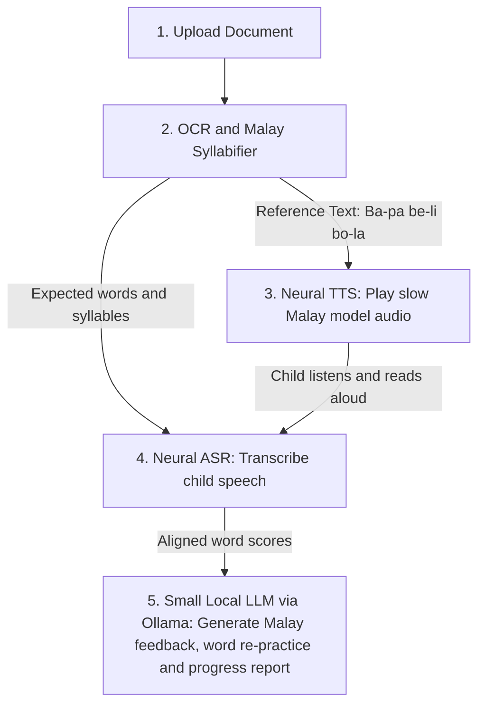

# Part C: Specialized Technology, Fundamental Concepts

## C1: Fundamental Concepts and How the Technology Works

The specialized technology selected for this project falls under Natural Language Processing (NLP) and Speech Language Processing. It combines Automatic Speech Recognition (ASR), Neural Text-to-Speech (TTS), and a Lightweight Local Large Language Model (LLM). Together with Optical Character Recognition (OCR) as the document input step, these technologies enable a computer to read printed text aloud, listen to human speech, evaluate pronunciation quality, and generate natural language feedback.

At the fundamental level, the speech and NLP pipeline operates through four core concepts.

### 1. Turning Sound into a Visual Map

When a child reads into the microphone, the computer captures their voice as a digital sound wave. AI models find it hard to read raw sound waves directly, so the system slices the audio into tiny split-second chunks. Each chunk is converted into a **spectrogram**, which is like a "heat map" image of the voice. It shows how strong each frequency is over time, in a way that matches how the human ear hears sound.

### 2. Converting Speech to Text

Next, an **Automatic Speech Recognition (ASR)** model reads these sound features and turns them into Malay text. This project uses the **Encoder-Decoder Transformer** approach (Radford et al., 2023). The model has two parts:

- **Encoder:** Looks at the spectrogram "heat map" to understand the speech sounds.
- **Decoder:** Writes out the predicted Malay words one by one.

### 3. Forced Alignment

Normal speech-to-text apps try to be helpful by auto-correcting mistakes based on sentence context. This is bad for a reading coach, because the system must catch when a child mispronounces a word. Since BacaBuddy already knows the correct sentence from the OCR step, it uses **Forced Alignment** (Bain et al., 2023; McAuliffe et al., 2017). Forced alignment lines up the child's voice recording word by word against the actual text on the page, and finds the exact start and end time of every word.

### 4. Lightweight Local LLM for Malay Feedback

After the system finds which words were read wrongly and calculates the score, it sends these results to a **small local LLM**. The local LLM writes a short, encouraging feedback message and a syllable tip in Bahasa Melayu. It runs completely offline, so the child's data stays private.

### Pipeline Flow

The flow below shows how a document moves through the BacaBuddy system, from upload to the final feedback and progress report.

**Figure 1: BacaBuddy Speech and NLP Processing Pipeline**

---

## C2: Frameworks, Models, Methods, and Tools

**Table 1: Frameworks, Models, Methods, and Tools Used in BacaBuddy**

| Tool / Model / Framework / Method                                                         | Type                                                                  | Role in BacaBuddy                                                                                                                                                                                                                                 |
| ----------------------------------------------------------------------------------------- | --------------------------------------------------------------------- | ------------------------------------------------------------------------------------------------------------------------------------------------------------------------------------------------------------------------------------------------- |
| **OpenAI Whisper** (Radford et al., 2023)                                                 | Encoder-Decoder Transformer ASR Model                                 | Used in its small or base variant to transcribe children's read-aloud Malay speech into text tokens, robustly, even under mild home or classroom background noise.                                                                                |
| **wav2vec 2.0** (Baevski et al., 2020)                                                    | Self-Supervised Speech Representation Model (CTC)                     | Learns latent acoustic representations directly from raw audio waveforms. It is fine-tuned using Connectionist Temporal Classification (CTC) on Malay speech to produce frame-level phoneme or character probabilities for pronunciation scoring. |
| **WhisperX** (Bain et al., 2023) and **Montreal Forced Aligner** (McAuliffe et al., 2017) | Phoneme and Word-Level Forced Alignment Tools                         | Align the ASR output against the known OCR reference text to obtain exact word timings, pauses, and word-level pronunciation scores.                                                                                                              |
| **Meta MMS-TTS** (Pratap et al., 2023) and **Piper TTS**                                  | Neural Text-to-Speech (VITS architecture)                             | Use Variational Inference with adversarial learning for end-to-end speech synthesis. They produce natural, clear Bahasa Melayu speech offline, so the child can hear a slow model reading of any uploaded sentence.                               |
| **Tesseract OCR** (Smith, 2007) and **Ollama**                                            | Optical Character Recognition Engine and Local Lightweight LLM Runner | Tesseract OCR extracts printed Malay text from uploaded page images and PDFs using LSTM line recognition. Ollama runs a small local LLM that generates safe, encouraging Malay feedback from the alignment scores.                                |

---

## C3: Fit to My Problem

### How the Technology Solves the Problem and Its Benefits

Combining OCR with a local Speech and NLP pipeline directly addresses the reading problem faced by young Malaysian children, parents, and teachers. Because BacaBuddy uses Tesseract OCR together with neural TTS and ASR, it does not depend on a preloaded story dataset. A teacher or parent can take a photo or upload a PDF of any Bahasa Melayu textbook page, and the system turns it into an interactive reading lesson on the spot.

Teachers with 35 students cannot listen to every child read every day. ASR and forced alignment act as a personal reading helper: the app listens to the child read aloud, checks every word against the page, and uses a local LLM to give friendly feedback in Malay right away. Because all models are compressed to run on a normal laptop, schools and families do not need an internet connection or paid subscriptions. Children's voice recordings are never uploaded to external cloud servers.

### Limitations and Risks

Although this technology fits the problem well, there are three main limitations and risks that must be managed.

1. **Child voice recognition accuracy:** Children aged 7 to 9 have higher-pitched voices and less stable pronunciation than adults. Standard ASR models trained only on adult voices often make mistakes when listening to children (Shivakumar & Georgiou, 2020). In addition, no open Malay children's reading dataset currently exists. To manage this risk, this project builds its own dataset, BacaKids-MY, from 40 to 60 children, and combines it with free public datasets such as speechocean762 (Zhang et al., 2021).
2. **Hardware limitation:** Running OCR, TTS, ASR, and an LLM on one laptop can slow the computer down or cause it to run out of memory. To manage this, smaller model versions are used during daily operation.
3. **Noise and image quality:** Loud classroom noise can make the ASR model mishear a child's voice. A dark or blurry phone photo of a book page can cause OCR spelling mistakes. To reduce these risks, users can edit the extracted OCR text before starting, and children can use a basic headset microphone.

### Comparison with Paid Cloud API

**Table 2: Comparison Between BacaBuddy Technology and Paid Cloud API**

| Category                         | BacaBuddy Technology                                                                   | Paid Cloud API                                                                     |
| -------------------------------- | -------------------------------------------------------------------------------------- | ---------------------------------------------------------------------------------- |
| **Child voice privacy**          | High privacy: children's voice recordings stay 100% on the laptop and never go online. | Low privacy: children's voice recordings must be sent to external company servers. |
| **Internet requirement**         | Works offline: can be used in rural schools or homes without internet.                 | Needs fast internet: stops working if the school Wi-Fi is slow or disconnected.    |
| **Cost**                         | Free: uses free open-source tools on a normal laptop.                                  | Paid subscription: charges money for every minute of audio and every text prompt.  |
| **Training on Malay child data** | Flexible: the model can be fine-tuned using our own dataset.                           | Locked: closed commercial models cannot be custom-trained on our dataset.          |
| **Hardware requirement**         | Needs a laptop with a dedicated GPU and small models.                                  | Can run on a very weak computer because all heavy work happens on cloud servers.   |

### Final Choice and Justification

I choose the BacaBuddy technology over a paid cloud API. Although cloud APIs are easier to run on weak computers, they do not solve the core problems of this project. They send underage children's voices to the cloud, require paid subscriptions and constant internet access that many schools and families cannot afford, and do not allow us to train an open Malay child pronunciation model on our own dataset. Running open-source models locally keeps the system free, private, offline, and tailored specifically for young Bahasa Melayu readers.
